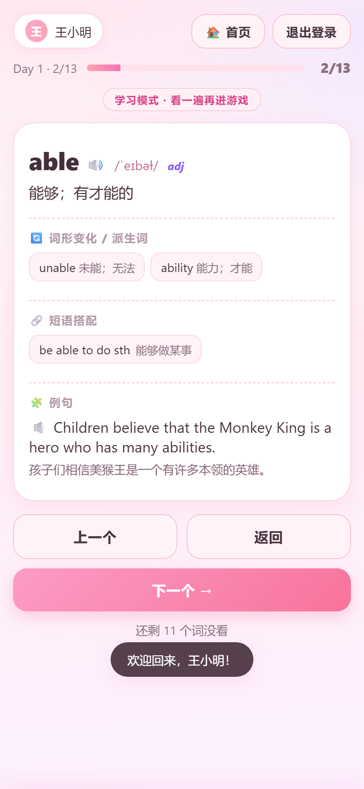
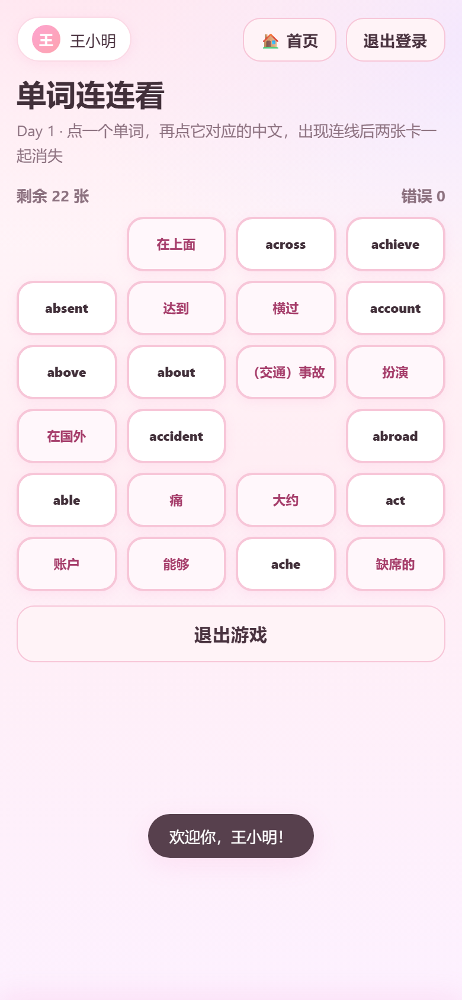
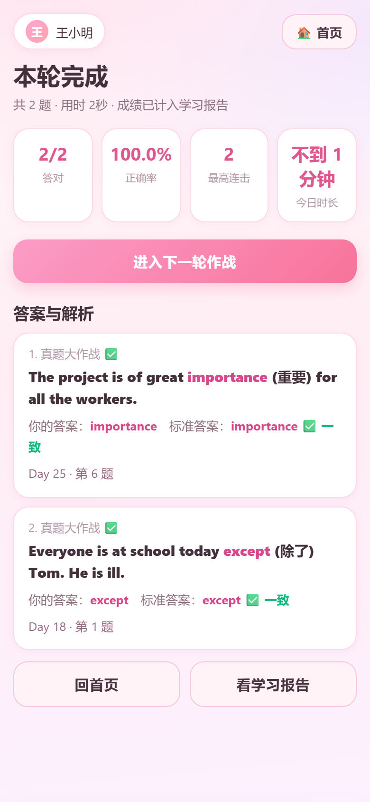

# 60天搞定中考词汇 ｜ 中考词汇训练网页生成器

把一本中考词汇书（或任何一份词表）变成学生手机浏览器就能用的**单文件 HTML 训练器**：先学后玩的三个词汇游戏、听写闯关、真题大作战、艾宾浩斯抗遗忘复习、错题本、学习报告、排行榜——全部内联在一个 HTML 里，学生用微信收到就能做，无需安装 App、无需联网（发音除外）。

由 **Elaine-Wu Yi** 设计并维护。

> 最初为一本中考英语词汇书（59 个 Day、1428 个词、334 道真题）开发，适用于任意教材/考试的词汇训练场景。

---

## 功能特性

- **先学后玩**：每个 Day 先逐词学习（音标 / 词性 / 释义 / 词形变化 / 短语搭配 / 带中文的例句），学完才解锁三个游戏
- **三个词汇游戏**（学完一个 Day 就能玩）：
  - **单词消消乐**：英文卡 ↔ 中文卡配对消除
  - **单词对对碰**：卡片背面朝上，翻两张配对
  - **单词连连看**：点单词再点对应中文，折线从**卡片之间的空白缝隙**绕行、不遮字，配对后线与两张卡同一帧消失
  - 游戏链式推进：消消乐 → 对对碰 → 连连看，通关可「再来一轮」或「学下一个 Day」
- **单词翻译官**：中→英 / 英→中随机切换，英文题用**网页内置 QWERTY 键盘**，彻底规避搜狗/百度/讯飞的联想补全
- **听写闯关**：只给发音不给释义，点「🔈 听发音」即读；配了离线语音包后**点击即刻出声（0 ms）**
- **真题大作战**：答案册里的 334 道真题，按标准答案严格判分（大小写、首尾空格归一化，`/` 分隔的可接受写法任一命中），每题给出你的答案 / 标准答案 / 原书解析
- **学习中心**：
  - **艾宾浩斯抗遗忘复习**：8 个记忆盒，间隔 0/1/2/4/7/15/30/60 天
  - **错题本**：自动收集默写与真题错题，可导出 A4 打印版（PDF）
  - **学习报告**：今日时长、学习天数、正确率、每次练习记录、汇总与建议，可导出 PDF
  - **排行榜**：本机所有账号按正确率 → 时长排序，标出「我的排名」
- **名字 + 密码登录**：一个名字一个密码（SHA-256 存储），每次打开都重新登录；同名即接回原记录，退出登录在右上角
- **手机端深度适配**：内置键盘、无 `prompt/alert/confirm`、390px 无横向溢出、刘海屏安全区
- **单文件交付**：CSS/JS/数据全部内联；离线语音包是可选的一个同级 `audio/` 文件夹

## 安装（给别人的一键装法）

本仓库就是一份 **AI Skill 包**：根目录有 `SKILL.md`，`scripts/`、`assets/`、`references/` 都是相对路径，
放到任何"技能目录"里即可用。三种装法任选：

### ① 一行命令（推荐）

```bash
git clone https://github.com/<你的用户名>/60days-zhongkao-vocab.git
cd 60days-zhongkao-vocab
./install.sh          # macOS / Linux / Windows 的 git-bash
# Windows PowerShell：
.\install.ps1
```

脚本会自动判断装到哪儿，也可以指定：

| 命令 | 装到 |
|---|---|
| `./install.sh --hermes` | `$HERMES_HOME/skills/productivity/60days-zhongkao-vocab`（Hermes Agent） |
| `./install.sh --claude` | `~/.claude/skills/60days-zhongkao-vocab`（Claude Code 等） |
| `./install.sh --target DIR` | 任何支持 `SKILL.md` 的助手 / 自己的技能目录 |

### ② 手动拖进去

把整个文件夹复制到对应目录，改名成 `60days-zhongkao-vocab`：

```
Hermes Agent   →  $HERMES_HOME/skills/productivity/60days-zhongkao-vocab/    (默认 ~/.hermes/…)
Claude Code    →  ~/.claude/skills/60days-zhongkao-vocab/
其他助手        →  任意 skills/ 目录，只要 SKILL.md 在技能根目录
```

装完在助手会话里说一句「用 60days-zhongkao-vocab 帮我把这份词表做成词汇训练页」即可触发。

### ③ 不用 AI 助手，直接当工具用

`scripts/` 全是普通 Python 脚本，装不装进助手都能跑：

```bash
python3 scripts/generate.py assets/sample-wordlist.json 示例.html   # 立刻得到可用的 HTML
```

## 界面预览

| 登录（名字 + 密码） | 首页 | 学单词（释义 / 变化 / 短语 / 例句带中文） |
|---|---|---|
|  |  |  |

| 连连看（线走缝隙、不遮字） | 真题大作战（你的答案 / 标准答案 / 解析） | 排行榜 |
|---|---|---|
|  |  |  |

## 快速开始

需要 Python 3（生成/OCR 脚本）与 Node.js（仅生成时做 JS 语法自检）。

```bash
# 1. 准备词表 JSON（格式见 references/wordlist-schema.md）
# 2. 生成训练页
python3 scripts/generate.py wordlist.json 60天搞定中考词汇.html

# 3. 双击生成的 HTML 即可在浏览器打开
```

`assets/sample-wordlist.json` 是一份 2 天的示例数据，`demo/示例-2天.html` 是用它构建的成品，可以先看效果。

### 从一本扫描版词汇书开始（完整流水线）

```bash
# 1) 逐页 OCR（扫描版 PDF 没有文字层）
python3 scripts/ocr_pdf.py 中考英语复习词汇.pdf ocr/

# 2) OCR 结果 → 词表 JSON（双栏词表、音标、短语、派生词、例句）
python3 scripts/parse_pdf.py ocr/ wordlist.json

# 3) 答案册 → 真题库（标准答案 + 解析）
python3 scripts/import_answers.py --words-ocr ocr/ --answers-ocr ans_ocr/ \
        --out assets/exercises-答案册.json

# 4) 生成页面
python3 scripts/generate.py wordlist.json 60天搞定中考词汇.html
```

### 可选：离线单词语音包

浏览器自带的英文音色在多数 Windows 上是**联网音色**，起麦要几百毫秒。想要「点了就响」就生成语音包：

```bash
python3 scripts/fetch_audio.py wordlist.json audio/ --workers 3
```

产出的目录结构：

```
60天搞定中考词汇（离线语音版）/
├── 60天搞定中考词汇.html
├── audio/<slug>.mp3        # 每个单词/短语一个录音
├── audio/manifest.json
└── 安装说明.txt
```

模板会先探测同级 `audio/` 是否存在：在就用本地 mp3（0 ms），不在就自动退回 `speechSynthesis`。**整个文件夹一起发给学生**；只发 html 也能用，但发音会走在线语音。

## 词库格式

```json
{
  "title": "60天搞定中考词汇（课标1600词）",
  "days": [
    {
      "day": "Day 1",
      "words": [
        {
          "en": "able", "ipa": "/ˈeɪbəl/", "pos": "adj", "cn": "能够；有才能的",
          "forms": [{"w": "ability", "label": "名词"}, {"w": "unable", "label": "反义词"}],
          "phrases": [{"en": "be able to do sth", "cn": "能够做某事"}],
          "ex": [{"s": "Children believe that the Monkey King is a hero who has many ____.",
                  "ans": "abilities", "zh": "孩子们相信美猴王是一个有许多本领的英雄。"}]
        }
      ],
      "phrases": [{"en": "take place", "cn": "发生"}]
    }
  ],
  "exercises": [
    {"d": "Day 1", "no": 3, "s": "Children believe that ... many ____ (able).",
     "h": "able", "ans": "abilities", "note": "空处作 of 的宾语，应用名词……"}
  ]
}
```

完整字段说明见 [`references/wordlist-schema.md`](references/wordlist-schema.md)。

- `cn` 用分号 `；` 分隔多个义项，答题时任一对上即算正确
- `ex[].zh` 是例句中文，学习页会显示在英文句子下面
- `exercises[]` 是真题库（`generate.py` 会自动从 `assets/exercises-答案册.json` 注入），`ans` 用于严格判分，`note` 是原书解析

## 项目结构

```
60days-zhongkao-vocab/
├── SKILL.md                         # AI Agent 技能说明（给 AI 助手使用）
├── README.md
├── LICENSE                          # MIT
├── NOTICE.md                        # 第三方数据/录音的来源与许可
├── requirements.txt
├── install.sh                       # 一键装进 Hermes / Claude Code / 指定目录
├── install.ps1                      # 同上（Windows PowerShell）
├── scripts/
│   ├── ocr_pdf.py                   # 扫描版 PDF → 逐页 OCR JSON
│   ├── parse_pdf.py                 # OCR → 词表 JSON（音标/释义/短语/派生词/例句）
│   ├── import_answers.py            # 答案册 OCR → 真题库（答案 + 解析）
│   ├── generate.py                  # 词表 JSON + 模板 → 单文件 HTML（含 JS 语法自检）
│   ├── fetch_audio.py               # 词表 → 离线单词语音包（mp3）
│   └── cdp_verify.js                # Edge headless + CDP 自动回归（断言/截图）
├── assets/
│   ├── coach-template.html          # 应用模板（浅粉主题 · 三游戏 · 内置键盘 · 学习中心）
│   ├── exercises-答案册.json        # 334 道真题（标准答案 + 解析）
│   └── sample-wordlist.json         # 2 天示例词表
├── references/
│   ├── wordlist-schema.md           # 词表 JSON 字段规范
│   ├── answer-key-import.md         # 答案册导入的完整套路与坑
│   ├── qa-cdp-checks.md             # 自动回归断言清单
│   └── print-export.md              # 错题本/复习计划/学习报告导出 A4（PDF）配方
└── demo/
    └── 示例-2天.html                # 用示例词表构建的成品，双击即可体验
```

## 数据来源与许可

- **本项目自有代码**（模板、脚本、SKILL.md、文档）：以 [MIT License](LICENSE) 发布，© 2026 Elaine-Wu Yi
- **`assets/exercises-答案册.json`**：整理自作者自有的《词汇答案册》纸质书（OCR + 人工校对），仅收录题目文本、标准答案与解析要点，供学习使用；如权利人认为不妥，请联系删除
- **`audio/`（离线语音包）**：由 `scripts/fetch_audio.py` 调用公开词典发音接口（有道词典美音，失败时回落百度 TTS）按需生成，**不随仓库分发**；生成物仅供个人/课堂学习使用，请勿再分发或商用
- **教材/词汇书原文**：词表数据由使用者自行从合法获得的纸质书/PDF 提取，本仓库不包含任何教材 PDF 原件

## 面向 AI 助手

本仓库本身即一个可复用的 AI Skill：把整个目录放进 AI 助手的 `skills/` 下，助手即可在你提供词表（PDF / 图片 / 文本）时自动 OCR、解析、导入答案册并生成训练页。完整工作流、硬约束与踩过的坑见 [`SKILL.md`](SKILL.md)。

## 作者

**Elaine-Wu Yi** ｜ 英语教师 · 词汇教学与测评工具

如果这个项目对你有帮助，欢迎 Star、提 Issue，或基于 `references/wordlist-schema.md` 换成自己的词汇书。
